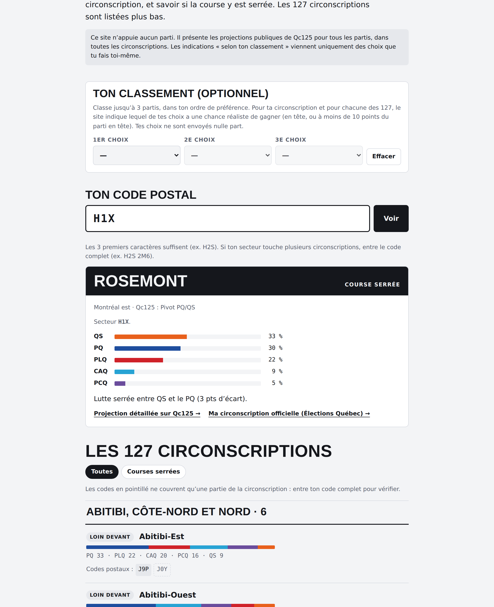
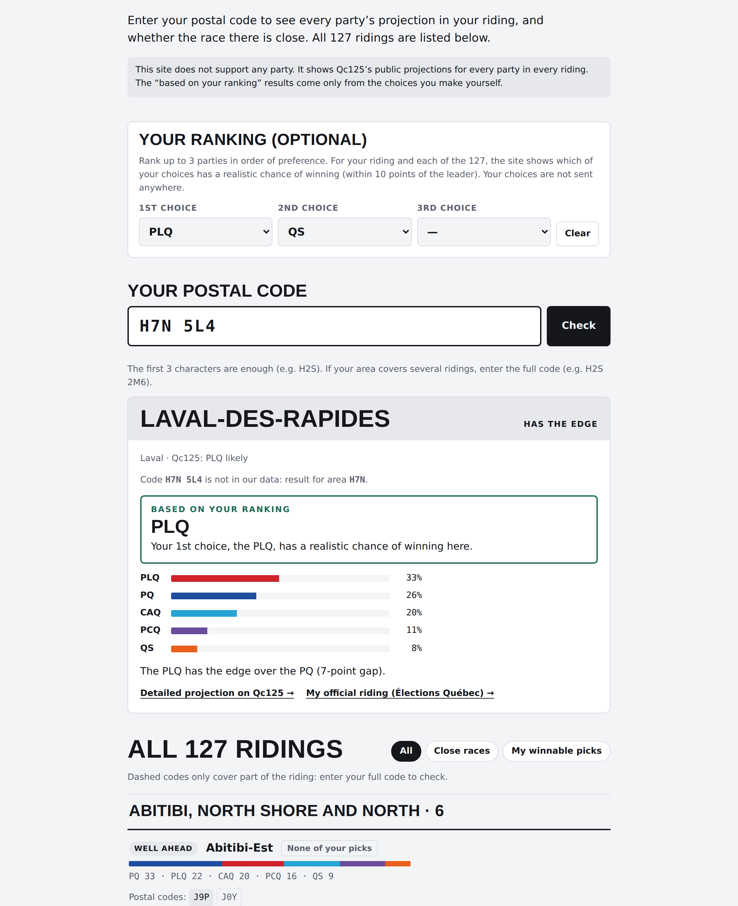

# Mon comté 2026 · My riding 2026

**FR** · Un outil web bilingue qui associe n’importe quel code postal québécois à sa circonscription et affiche les projections de vote de tous les partis pour les 127 circonscriptions de l’élection générale québécoise du 5 octobre 2026.

**EN** · A bilingual web tool that matches any Quebec postal code to its electoral riding and shows every party’s vote projection for all 127 ridings in the October 5, 2026 Quebec general election.



---

## Le problème · The problem

Les projections par circonscription existent (Qc125), mais elles sont réparties sur 127 pages et la plupart des gens ne savent pas dans quelle circonscription ils votent. Cet outil répond en quelques secondes à une seule question : *que se passe-t-il dans ma circonscription ?*

Riding-level projections exist (Qc125), but they are spread over 127 pages and most people don’t know which riding they vote in. This tool answers one question in seconds: *what’s happening in my riding?*

## Fonctionnalités · Features

- **Code postal → circonscription** : les 3 premiers caractères suffisent; le code complet règle les secteurs partagés. · **Postal code → riding**: the first 3 characters are enough; the full code resolves split areas.
- **Projection de tous les partis** (PQ, PLQ, CAQ, PCQ, QS) et statut de la course : serrée (< 5 pts), avantage (5–10 pts), loin devant (> 10 pts). · **Every party’s projection** and race status: close, has the edge, well ahead.
- **Classement personnel (optionnel)** : le visiteur classe jusqu’à 3 partis; l’outil indique, pour chaque circonscription, le mieux classé de ses choix qui est en tête ou à moins de 10 points du parti en tête. · **Optional personal ranking**: the visitor ranks up to 3 parties; for each riding the tool shows their highest-ranked choice that leads or is within 10 points of the leader.
- **Liste des 127 circonscriptions** par région, avec filtres « courses serrées » et « mes choix gagnables ». · **All 127 ridings** by region, with “close races” and “my winnable picks” filters.
- **Bilingue FR/EN**, thème clair/sombre, mobile. Aucune donnée n’est envoyée : tout se calcule dans le navigateur. · **Bilingual**, light/dark, mobile. No data leaves the browser.



## Neutralité · Neutrality

L’outil n’appuie aucun parti. Tous les partis sont traités de la même façon (ordre alphabétique, aucune présélection) et les indications de classement proviennent uniquement des choix du visiteur. La première version du projet recommandait des partis; elle a été retirée après analyse des règles de la *Loi électorale* du Québec sur les dépenses des tiers en période électorale, puis refaite sous cette forme neutre.

The tool supports no party. Every party is treated the same (alphabetical order, nothing pre-selected), and ranking results come only from the visitor’s own choices. The first version recommended parties; it was withdrawn after reviewing Quebec’s *Election Act* rules on third-party spending during the election period, and rebuilt in this neutral form.

## Fonctionnement · How it works

```
data/projections_qc125.csv   Qc125 projections, 5 parties × 127 ridings
data/ridings.csv             riding id, name, region, incumbent, Qc125 rating
        │
scripts/fetch_sources.sh     downloads 2026 boundaries (GeoJSON) + postal code centroids
scripts/build_data.py        point-in-polygon: 226,639 postal codes → riding
                             outlier correction (~1,800 misplaced centroids)
                             compact per-FSA lookup table
scripts/check.py             consistency checks (shares ≈ 100 %, known postal codes)
scripts/build_site.py        injects the data into src/template.html → index.html
```

**Appariement code postal → circonscription** · Chaque code postal a une coordonnée (centroïde). On teste dans quel polygone de la carte électorale 2026 il tombe (Shapely + index spatial STRtree). Certaines coordonnées de la source sont fausses; un code très éloigné du reste de son secteur (FSA), dans une circonscription rare pour ce secteur, reçoit la circonscription habituelle du secteur.

**Postal code matching** · Each postal code has a centroid. We test which 2026 riding polygon contains it (Shapely + STRtree spatial index). Some source coordinates are wrong; a code far from the rest of its FSA, in a riding that is rare for that FSA, gets the FSA’s usual riding instead.

### Reconstruire · Rebuild

```bash
pip install shapely
bash scripts/fetch_sources.sh
python scripts/build_data.py && python scripts/check.py && python scripts/build_site.py
```

Ouvrir `index.html` dans un navigateur. · Open `index.html` in a browser.

## Limites · Limitations

- Une projection n’est pas un sondage : marges de ±5 à ±10 points par circonscription. · A projection is not a poll: margins of ±5 to ±10 points per riding.
- Les projections datent des 27–28 septembre 2026 (Qc125). · Projections are from September 27–28, 2026.
- L’appariement code postal → circonscription est approximatif (codes postaux de 2024, centroïdes). Confirmer auprès d’Élections Québec. · Postal code matching is approximate (2024 codes, centroids). Confirm with Élections Québec.

## Sources et licences · Sources and licences

- Projections : [Qc125](https://qc125.com) (Philippe J. Fournier). Projet indépendant, sans lien avec Qc125. · Independent project, not affiliated with Qc125.
- Limites de la carte électorale 2026 : Élections Québec, via le projet ouvert [silatendancesemaintient](https://github.com/essicolo/silatendancesemaintient) (GPL-3.0).
- Codes postaux · Postal codes : [canada-postal-codes](https://www.npmjs.com/package/canada-postal-codes) (MIT).
- Ce dépôt est publié sous licence GPL-3.0 (voir `LICENSE`). · This repository is licensed under GPL-3.0 (see `LICENSE`).

Réalisé par Adam ([@adamrh007](https://github.com/adamrh007)), avec l’aide d’outils d’IA. · Built by Adam, with the help of AI tools.
